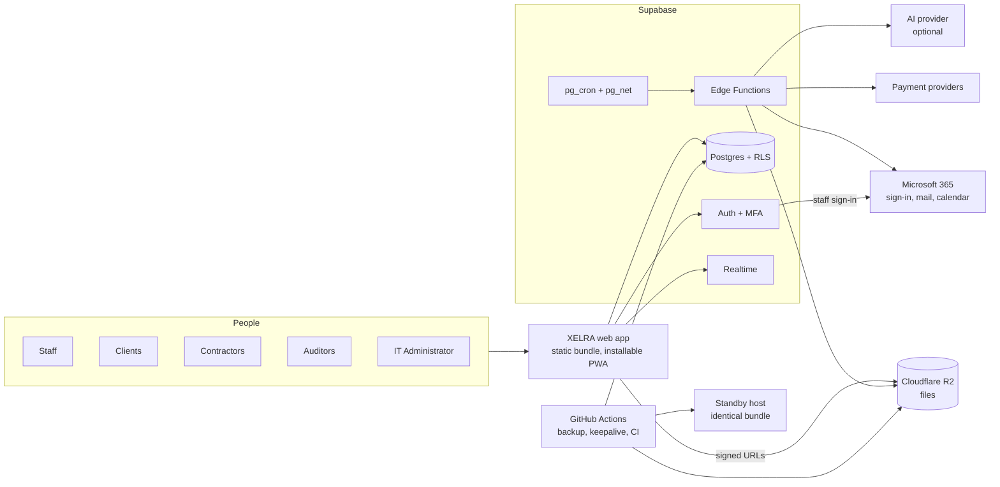
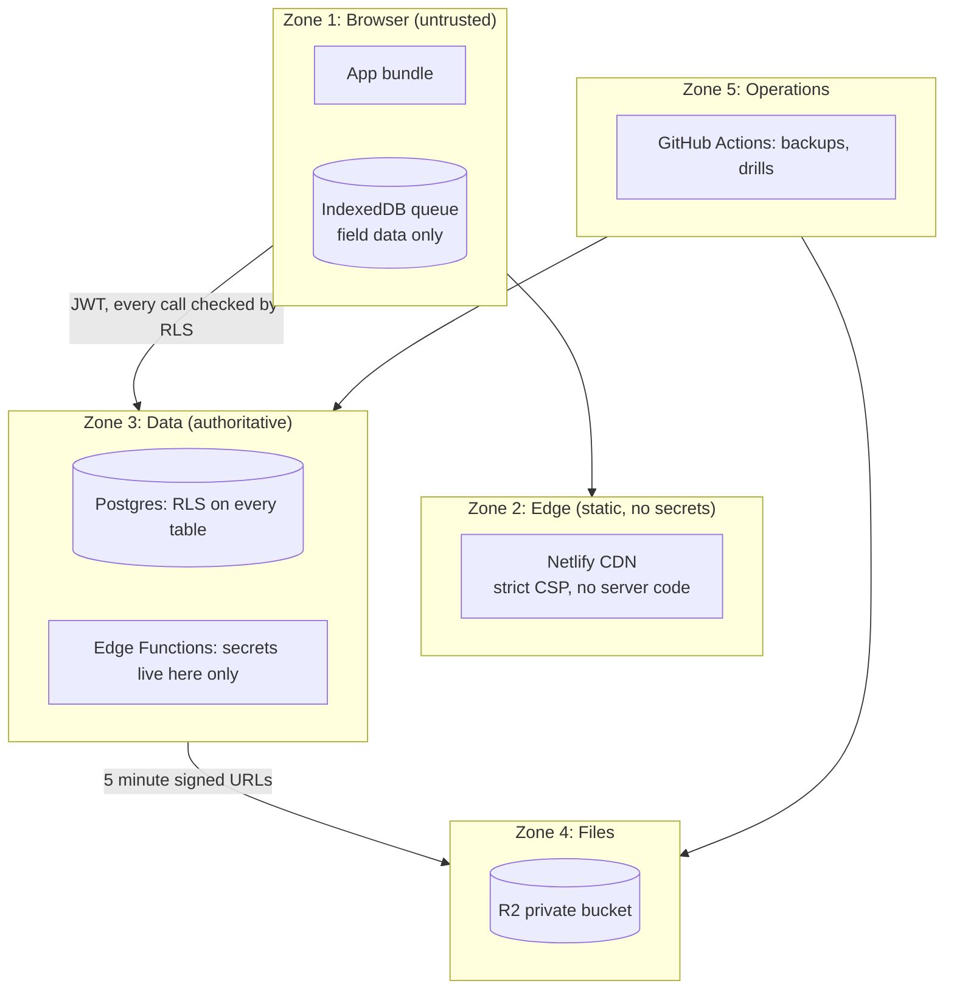
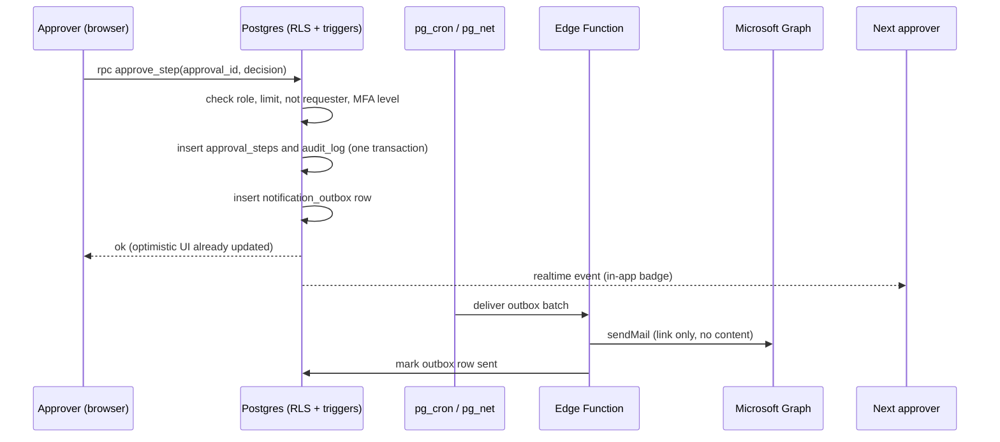
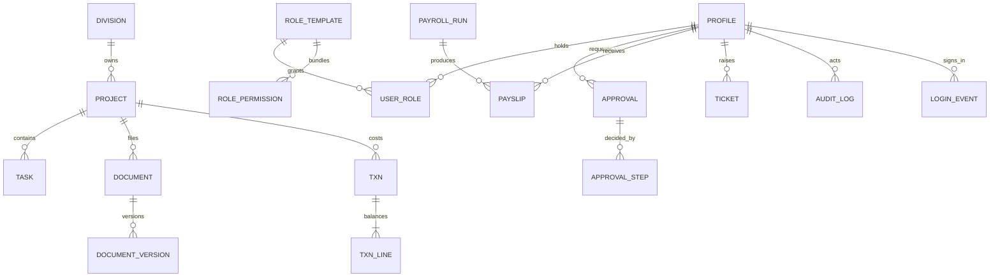
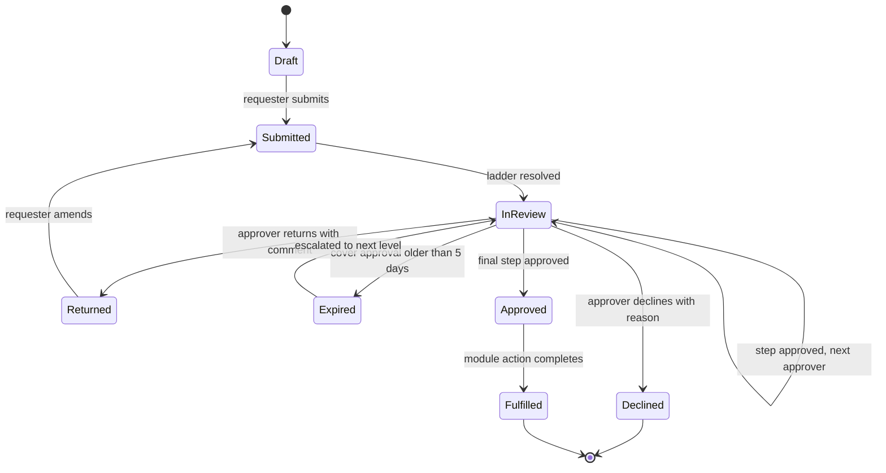

# XELRA Blueprint

Infrastructure, backend, UI and UX for Dreniak's all-in-one operations platform.
Prepared for Hamba, VAIS Applied Intelligence Systems. Version 1.0, 26 November 2026. Delivery deadline: end of January 2027.

This blueprint supersedes two earlier choices in the Master Plan and Sprint 0 prompt: hosting moves to a static-first design (section 2.5), and Supabase Pro is treated as an expected first-year cost (section 13.2). Everything else in those documents still holds.

---

## 0. Read this first

### 0.1 What was verified

The design was tested, not just described. Two harnesses ship in `xelra-sim-kit.zip`: one runs eight database invariant suites on real Postgres 16, the other runs Monte Carlo scenarios for capacity, hosting credits, offline sync, approvals, payroll shape and colour accessibility. Every number quoted below comes from those runs. Assumptions sit at the top of each script, so you can change one and rerun.

### 0.2 Seven findings that shape the build

| # | Finding | Evidence | What changes |
| --- | --- | --- | --- |
| 1 | Server-rendered Next.js on Netlify Free runs out of credits at the client's size | At 52 users the median month costs 306 credits against a 300 cap, and 54% of months exceed it. At 124 users the median is 605. A static-first build stays near 100 credits at every size tested | Static-first, thin-server architecture (section 2.5) |
| 2 | The free 500 MB database is reached inside the first year | Without pruning, 400 MB arrives at month 10 (median) and the database is about 534 MB at month 12. With pruning and archiving it arrives at month 16 | Retention jobs from day one, and Supabase Pro ($25 a month) written into the quotation as an expected item (13.2) |
| 3 | File storage passes R2's free 10 GB around month 8 | Month 8 uncompressed, month 15 to 16 with on-device photo compression. Cost afterwards is about $0.10 a month at month 12 and $1.39 at month 36 | Compress photos in the browser, keep R2 for files |
| 4 | Offline conflict handling decides whether field data is trusted | Record-level last-write-wins silently loses 8.9% of edits. Field-level merge loses 3.1%. An append-only event log with server rules loses none and needs a human decision on about 1% | Event-log sync for field reporting (10.4) |
| 5 | Approval chains stall without a fallback | 3.43% of requests wait more than 5 days (the cover-approval expiry) with no fallback. With delegates plus escalation after 2 days the figure is 0.07% | Delegation and escalation are core, not optional (6.3) |
| 6 | The row-level security pattern matters as much as the rules | A set-based policy is 37 to 44 times faster than a per-row function at 300,000 rows (about 40 ms against 1,700 ms) | One policy pattern for every table (5.2) |
| 7 | Brand grey borders fail accessibility for interface controls | The site's line colour #dcdcd9 measures 1.28:1 against paper and needs 3:1 for control boundaries | Decorative lines keep the brand colour, control borders use #858581 at 3.45:1 (15.2) |

### 0.3 Map

1. Context and design north star
2. Architecture, diagrams and the hosting decision
3. Data spine and row-level security
4. Workflow, ledger and retention engines
5. Module blueprint
6. Money
7. External surfaces: client, contractor, auditor
8. Field reporting and offline sync
9. Helpdesk and technical admin
10. AI assistant
11. Infrastructure as code
12. Failure modes, simulations and drills
13. Costs and upgrade triggers
14. UX and UI system
15. Screens, examples and accessibility
16. Scenarios to experiment with
17. Build gates
18. Research notes and open items

(Section numbers inside the text follow the headings below.)

---

## 1. Dreniak context and design north star

### 1.1 What the live site and repository show

Dreniak describes itself as engineering and asset management brought together "to engineer the longevity of civilisation." The site is dark and cinematic at the top (theme colour #080808), editorial in typography, and built around two disciplines that share one origin. Practical facts that matter for XELRA:

- Offices and reach: UK and East Africa. Engineering is delivered by ERB-registered engineers in Uganda. Asset Management serves owners of complex, long-life infrastructure.
- Founder and director: Darren Kamunuga. Engineering director: Derrick Nkurunungi.
- Brand tokens in the repository: red `#991923`, indigo `#0d3251`, ink `#111`, paper `#f7f7f5`, muted `#646464`, line `#dcdcd9`.
- Typography: the brand font is Sweet Sans Pro. The site uses Inter as a flagged substitute pending licensing. Weight contrast (heavy headlines, light body) is part of the approved system.
- Signature devices: a logo mark built from layered arcs, mirrored into a subtle repeating motif; duotone photography in the division colour (red wash for Engineering, indigo wash for Asset Management); uppercase tracked eyebrow labels (letter-spacing 0.1 to 0.16em); square corners with the occasional asymmetric curve (for example `4px 48px 4px 4px`).
- Voice: confident, measured, infrastructural. The values are written as short manifesto statements ("Question everything").

### 1.2 North star

> XELRA is the website's calm precision applied to daily work: paper-light surfaces, dark command moments, one accent per division, numbers that line up, and nothing that makes a person wait or lose work.

Four promises, each testable:

| Promise | Test |
| --- | --- |
| Fast | Any common task is reachable in three clicks or one keystroke. First useful screen under 2 seconds on a mid-range Android phone over 3G |
| Clear | One primary action per screen. A new staff member completes a leave request without training |
| Trustworthy | Every figure links to its source. Every sensitive action leaves a permanent record |
| Kind | Work is never lost: offline capture, autosave, undo for 10 seconds on reversible actions |

### 1.3 Ten moments designed to impress the client

1. A login screen where the Dreniak mark splits down its centreline and opens into the workspace.
2. A director home with a "Needs you" queue: approve or return in place, no navigation.
3. A command palette (Ctrl or Cmd plus K) that reaches every action and record.
4. An approval ladder that shows exactly who has signed, who is next, and who covers if someone is away.
5. Auditor activity with a colour badge per person, so "who did what" reads at a glance.
6. An offline site diary with a visible sync chip, captured in a field with no signal.
7. A payslip and leave view that explains every figure in plain words.
8. A project health matrix across both divisions with budget burn and milestone drift.
9. Document numbers generated automatically (`DRN-ENG-P014-RPT-0007-R02`) with instant search across the company.
10. A helpdesk that captures the page, role, browser and error reference automatically, so a user only types the problem.

---

## 2. Architecture

### 2.1 Five shapes, built once

Twenty-five modules look like a large system. Nearly all of them are one of five reusable shapes with a thin layer of module-specific rules. Building the shapes once and instantiating them is what makes the January deadline plausible and keeps behaviour consistent for users.

| Shape | What it is | Instances |
| --- | --- | --- |
| Entity | A record with a lifecycle and an owner | Employee, project, task, supplier, client, asset, ticket, candidate, equipment item, contractor |
| Scope | The rule for who sees what: self, team, division, project, all | Every table, every screen, every export, the AI assistant |
| Workflow | A request that moves through approvals to fulfilment | Leave, expense, requisition, booking, site visit, payroll run, hire, document release, role grant, auditor seat |
| Ledger | Append-only events that can never be edited | Audit log, attendance, money journal, ticket history, approval steps |
| Document | A file with a number, versions and acknowledgements | Policies, contracts, drawings, reports, receipts, payslips, legacy files |

What stays module-specific (the residual): payroll arithmetic, bank statement matching, appraisal scoring, offline sync rules, budget and forecast formulas, and each module's screens. These are the parts that deserve the most testing time.

### 2.2 Context



### 2.3 Trust zones



Rule of the architecture: the browser is never trusted. Every read and write is judged by Postgres using the caller's own token. No secret exists outside Zone 3 and Zone 5.

### 2.4 Example request flow: approving an expense



### 2.5 Hosting decision: static-first, thin server

**The problem.** Netlify's free plan is a hard cap of 300 credits a month, charged at 15 credits per production deploy, 10 per GB-hour of function compute, 20 per GB of bandwidth and 2 per 10,000 requests. A server-rendered app spends credits on every page view. A static app spends them almost only on deploys.

**Simulation** (70 route changes per user per working day, 22 days, 6 production deploys a month, 4,000 runs per row):

| Users | Server-rendered median | 90th percentile | Months over 300 | Static-first median |
| --- | --- | --- | --- | --- |
| 20 | 174 | 212 | 0.2% | 94 |
| 52 | 306 | 409 | 54.1% | 100 |
| 124 | 605 | 844 | 99.9% | 113 |

Supabase egress (5 GB free) is the same either way because both designs read the same database: about 1.2 GB (90th percentile 1.8) for 52 users and 2.9 GB (90th percentile 4.2) for 124 users.

**Decision.** Build the app as a static export (`output: "export"`). Pages are static shells. Data comes straight from Supabase under row-level security. Anything needing a secret or an outbound call runs in a Supabase Edge Function. Netlify serves files and nothing else.

| Concern | Server-rendered | Static-first |
| --- | --- | --- |
| Netlify credits | Grow with use | Flat, deploys dominate |
| Where authorization lives | Server code and RLS | RLS only (stronger: one place) |
| Secrets in browser | None | None (anon key is public by design, RLS protects data) |
| Failover | Needs a compatible server host | Same folder deploys to any static host in minutes |
| Cost of a mistake in server code | Data exposure | No server code to get wrong |
| Constraint | None | No middleware, no route handlers, no cookies read on the server |

**Consequences to design for.**
- Route protection happens in the client guard and, for real, in RLS. A bypassed guard shows an empty shell and no data.
- Sessions live in browser storage, so the strict CSP generated by `scripts/csp-hashes.mjs` (11.2) is mandatory, JWTs are short-lived, and sensitive policies require MFA level aal2.
- Deploy discipline: preview and branch deploys are free, production deploys cost 15 credits. Ship production only from a release tag, at most 6 a month. Twenty deploys would use the whole month.
- Warm standby: the same bundle publishes to Cloudflare Pages on every release tag (11.4). Failover is a DNS change, so keep the record's TTL at 300 seconds.
- Privileged work list (all in Edge Functions or `security definer` RPCs): invitations, email sending, file signing, payment webhooks, payroll runs, exports, the AI assistant, scheduled jobs.

---

## 3. Data spine

### 3.1 Conventions that prevent whole classes of bugs

- Primary keys are UUIDs. Every timestamp is `timestamptz` stored in UTC and displayed in the viewer's time zone.
- Money is `bigint` in minor units plus `currency char(3)` plus the `fx_rate` used on the day. Floats never touch money. UGX amounts are whole shillings, GBP and USD use pence and cents.
- Every row carries its scope: `division_id`, `project_id`, or `owner_id` (self). A table with no scope column is a design error and fails review.
- Writes arriving from a queue carry an idempotency key with a unique index, so a retried request never doubles an action.
- Deletes are soft (`deleted_at`) and restoring needs a Director's approval. Ledger tables cannot be deleted from at all.
- Migrations are forward-only, one concern per file, named `YYYYMMDDHHMMSS_name.sql`, and each ships with the invariant test that proves its rules.

### 3.2 Core entities



### 3.3 Table families

| Family | Tables | Shape | Scope key |
| --- | --- | --- | --- |
| Identity and structure | profiles, divisions, departments, role_templates, role_permissions, user_roles, delegations, consent_documents | Entity | division |
| People | employment_records, contracts, leave_types, leave_balances, leave_requests, holidays, attendance (login_events), timesheets, candidates, onboarding_items, appraisals, training_records, certifications, equipment_items, benefits, cases (discipline and grievance) | Entity, Workflow | self, division |
| Projects | projects, tasks, milestones, project_members, field_events, incidents, quality_records, project_ratings | Entity, Ledger | project |
| Money | txns, txn_lines, budgets, expenses, requisitions, quotations, supplier_bills, invoices, payments, bank_statement_lines, fixed_assets, tax_records | Entity, Ledger | project, division |
| Payroll | payroll_runs, payslips, statutory_rates, pay_items, pay_item_assignments | Workflow, Ledger | restricted |
| Documents | documents, document_versions, acknowledgements, doc_counters, policies | Document | project, division |
| External | client_accounts, client_users, contractors, contractor_access, auditor_accounts, auditor_seats | Entity | project |
| Platform | approvals, approval_steps, audit_log, notification_outbox, notifications, tickets, ticket_events, ticket_attachments, ops_heartbeats, ops_meters, settings | Workflow, Ledger | system |

---

## 4. Scope and row-level security

### 4.1 Roles are data

The IT Administrator creates people and picks a department and a role. Roles, permissions and limits live in tables, not in code, so the client can adapt the organisation without a release.

```sql
create table role_templates(key text primary key, label text not null, sensitive boolean not null default false);
create table role_permissions(role_key text references role_templates, perm text, primary key(role_key, perm));
create table user_roles(
  user_id uuid references profiles, role_key text references role_templates,
  division_id text references divisions,          -- null means every division (the combined view)
  expires_at timestamptz, consent_doc uuid        -- uploaded Director consent, required for sensitive roles
);
create unique index on user_roles(user_id, role_key, coalesce(division_id,'*'));
```

A sensitive grant without an uploaded consent document is rejected by the database itself, whoever tries it (test T9):

```sql
create function private.require_consent() returns trigger language plpgsql as $$
begin
  if new.role_key in ('central_director','director_eng','finance_manager','hr_lead','it_admin') and new.consent_doc is null
  then raise exception 'sensitive role grant requires consent document'; end if;
  return new;
end $$;
create trigger user_roles_consent before insert or update on user_roles
  for each row execute function private.require_consent();
```

Sixteen seeded templates: Central Director, Director (Engineering), Department Head, Project Lead, Engineer or Consultant, Finance Manager, Finance Officer, HR Lead, HR Officer, Admin Assistant, Intern or Trainee, Legal Consultant, Auditor seat, Client user, Contractor, IT Administrator.

### 4.2 One policy pattern for every table

Policies that call a function for each row are the most common cause of slow row-level security. The rule: compute the caller's allowed scopes once per statement, then compare the column to that set.

```sql
create function private.my_divisions(p text) returns setof text
language sql stable security definer set search_path = public as $$
  select distinct d.id from user_roles ur
  join role_permissions rp on rp.role_key = ur.role_key and rp.perm = p
  join divisions d on (ur.division_id is null or ur.division_id = d.id)
  where ur.user_id = auth.uid() and (ur.expires_at is null or ur.expires_at > now())
$$;

create policy project_read on projects for select to authenticated
  using (division_id in (select private.my_divisions('project.read')));
```

Measured on 300,000 expense rows with the same data in two tables:

| Policy style | Time to count rows as a Director | Relative |
| --- | --- | --- |
| Function called per row | 1,757 ms | 1x |
| Set computed once per statement | 40 ms | 44x faster |

Rules that go with the pattern:
1. Index every scope column used by a policy (`division_id`, `project_id`, `owner_id`).
2. Name the role in the policy (`to authenticated`) and use `force row level security` on sensitive tables.
3. Avoid joins inside policies. Put the join in a `security definer` function with a fixed `search_path`, and revoke `execute` from `public`.
4. Keep an explicit filter in client queries as well (`.eq('division_id', id)`). The policy is the guard, the filter helps the planner.
5. A table without a policy returns nothing. New tables ship with their policy and their test in the same migration.

### 4.3 Sensitive data

Payslips, bank details, contract terms and disciplinary files sit behind a second condition: the session must have passed MFA.

```sql
create policy payslip_read on payslips for select to authenticated using (
  (select auth.jwt() ->> 'aal') = 'aal2'
  and ( user_id = (select auth.uid()) or (select private.has_perm('payroll.read')) )
);
```

Bank account numbers are stored encrypted at column level with the key held in Supabase Vault, and displayed masked (last four digits). Disciplinary cases live in their own table family readable only by HR and the Directors concerned, with complainant and respondent each seeing their own part.

### 4.4 The IT Administrator boundary (tested)

| Capability | IT Admin | Central Director | Director (Eng) | Finance Manager | HR Lead | Employee |
| --- | --- | --- | --- | --- | --- | --- |
| Create and deactivate users | Yes | Yes | No | No | No | No |
| Grant sensitive roles | With consent document | Yes | No | No | No | No |
| Read salaries and bank details | No | Yes | Yes | Yes | Yes | Own only |
| Read disciplinary files | No | Yes | Case only | No | Yes | Own case |
| Read project and finance data | No | Yes | Own division | Yes | No | Scoped |
| System health, errors, meters | Yes | Summary | No | No | No | No |
| Reset authenticator, revoke sessions | Yes | No | No | No | HR request | Self |
| Read the audit log | System and own | Yes | Own division | Finance events | HR events | Own |
| Approve a Director's request | No | Yes | No | No | No | No |

Tests T1 and T2 prove the central claim: with the IT Administrator role the count of readable project rows and payslip rows is zero.

Break-glass: an urgent need to see restricted data creates a time-boxed grant (30 minutes) that a Director approves, the audit log records, and the Directors see in a monthly review of the IT Administrator's own trail.

---

## 5. Workflow, ledger and retention engines

### 5.1 One approval engine



Leave, expenses, requisitions, vehicle or equipment bookings, site visits, payroll runs, hires, document releases, role grants and auditor seats all use it. Each module supplies only a form definition and a fulfilment action.

### 5.2 Ladder, segregation and delegation (tested)

The ladder is data: `approval_limits(role_key, max_amount)`, scaled by the Directors' factor and edited in settings. The database refuses a decision that breaks any of these rules (test T3):

```sql
create function private.check_step() returns trigger language plpgsql as $$
declare a approvals;
begin
  select * into a from approvals where id = new.approval_id;
  if new.approver = a.requester then raise exception 'segregation of duties: requester cannot approve'; end if;
  if private.approver_limit(new.approver, a.division_id) < a.amount then raise exception 'above approver authority'; end if;
  if (select status from profiles where id = new.approver) <> 'active' then raise exception 'approver inactive'; end if;
  return new;
end $$;
```

`approver_limit` returns the highest limit the person holds through their active roles or through a live delegation, and a delegation can carry a lower cap than the role it borrows. The Engineering Pro-Consultant is the standing delegate for the Engineering director, capped at the department-head limit by default.

**Stall protection (test S5).** A cover approval expires after 5 days. Simulating 6,000 requests with realistic absences:

| Policy | Median wait | 90th percentile | Over 5 days |
| --- | --- | --- | --- |
| No fallback | 0.89 days | 1.96 days | 3.43% |
| Delegate, then escalate after 2 days | 0.90 days | 2.15 days | 0.07% |

Median speed is unchanged. The fallback removes the long tail, so it ships in the first version.

### 5.3 Ledgers are append-only in the database, not by convention

Audit log, approval steps, money journal and ticket events reject update, delete and truncate (test T4):

```sql
create function private.audit_immutable() returns trigger language plpgsql as $$
begin raise exception 'audit_log is append-only'; end $$;
create trigger audit_no_row before update or delete on audit_log
  for each row execute function private.audit_immutable();
create trigger audit_no_trunc before truncate on audit_log
  for each statement execute function private.audit_immutable();
```

What is recorded: approvals, pay changes, exports, deletions, role changes, restores, auditor actions, break-glass grants. What is never recorded: keystrokes, page views, screen content. Audit rows are deliberately narrow (about 450 bytes) because they are the largest table by volume.

### 5.4 Attendance and retention

Attendance is a ledger of sign-in, sign-out and timeout events. After 12 months the IT Administrator receives a prompt to export a CSV. The export is checksummed, the Administrator confirms the download, and only then does the purge run. The purge refuses unless the export is confirmed and its row count still matches the live rows (test T6):

```sql
create function private.purge_login_events(export_id int) returns int language plpgsql as $$
declare e login_exports; n int; c int;
begin
  select * into e from login_exports where id = export_id;
  if e.id is null or e.confirmed_at is null or e.sha256 is null then raise exception 'purge refused: export not confirmed'; end if;
  select count(*) into c from login_events where at >= e.from_ts and at < e.to_ts;
  if c <> e.row_count then raise exception 'purge refused: row count differs from export'; end if;
  delete from login_events where at >= e.from_ts and at < e.to_ts; get diagnostics n = row_count;
  insert into audit_log(action, entity, entity_id, data)
    values ('purge','login_events', export_id::text, jsonb_build_object('rows', n, 'sha256', e.sha256));
  return n;
end $$;
```

Retention jobs (scheduled inside the database with `pg_cron`, so they need no outside runner):

| Job | Schedule | Action |
| --- | --- | --- |
| Notification prune | Weekly | Delete read notifications older than 90 days |
| Message cold archive | Monthly | Move threads idle for 12 months to compressed JSON in R2 |
| Audit partition archive | Monthly | Export closed partitions to R2 with a hash chain, keep the hash and index rows |
| Login export prompt | Monthly | Create a task for the IT Administrator when rows pass 12 months |
| Expiry reminders | Daily | Registrations, contracts, probation at 60 and 14 days |
| Heartbeat check | Hourly | Alarm if no backup in 30 hours or no keepalive in 3 days |
| Ticket screenshot purge | Hourly | Delete attachments of resolved tickets |

### 5.5 Gap-free, collision-free document numbers (tested)

```sql
create function private.next_doc_no(p text, t text) returns int language sql as $$
  insert into doc_counters(project, doc_type, last) values (p, t, 1)
  on conflict (project, doc_type) do update set last = doc_counters.last + 1
  returning last $$;
```

Test T5 ran 8 concurrent sessions allocating numbers for the same project and type, with 10% of transactions randomly rolled back: 1,068 numbers committed, no duplicates, no gaps, no errors. A rolled-back transaction rolls back its increment, which is why no gaps appear. The full number is assembled as `DRN-{division}-{project}-{type}-{seq:0000}-R{rev:00}`.
